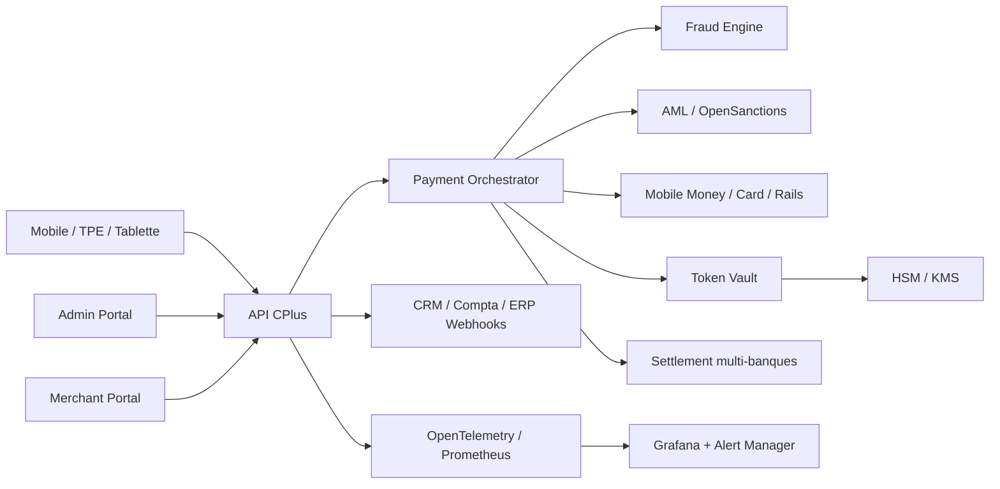

# Feuille de route recommandee vers CPlus 3.0

Objectif: transformer CPlus 2.6.0 en plateforme CPlus 3.0 plus securisee, observable, conforme et multi-tenant, prete pour exploitation a grande echelle.

## Priorite 1 - 30 jours: Fraud & AML

### Fraud Engine
- Ajouter un moteur de scoring transactionnel temps reel.
- Produire un score de risque par transaction: `low`, `medium`, `high`, `blocked`.
- Declencher des actions: autoriser, demander verification, bloquer, mettre en revue.

### AML Engine
- Ajouter des controles anti-blanchiment sur collect, payout, settlement et activite marchand.
- Detecter les comportements atypiques: fractionnement, volumes anormaux, comptes dormants, transactions circulaires.

### OpenSanctions
- Integrer OpenSanctions pour filtrage sanctions, PEP et watchlists.
- Appliquer le screening sur marchands, beneficiaires, administrateurs et comptes de settlement.
- Journaliser les resultats de screening pour audit.

### Device Fingerprint
- Generer une empreinte terminal: device model, OS, app version, Android ID/iOS identifier, IP, geolocalisation si autorisee.
- Relier chaque transaction au terminal et au profil de risque device.

### Velocity Rules
- Ajouter des regles de velocite:
  - nombre de transactions par minute/heure/jour,
  - montant cumule,
  - tentatives echouees,
  - nouveaux devices,
  - changement pays/IP.
- Permettre configuration par pays, marchand, KYB level et moyen de paiement.

### Criteres d'acceptation
- Chaque transaction recoit un `risk_score`.
- Les transactions bloquees sont visibles dans le portail admin.
- Les decisions Fraud/AML sont historisees dans un journal d'audit.
- Les regles de velocite sont modifiables sans redeployer le code.

## Priorite 2 - 60 jours: Observabilite & exploitation

### Prometheus
- Exposer `/metrics` sur l'API.
- Publier les metriques: latence API, taux d'erreur, transactions par provider, approvals, declines, webhooks, queue settlement.

### Grafana
- Creer dashboards:
  - plateforme globale,
  - paiements Mobile Money,
  - gateways carte,
  - settlements,
  - fraude/AML,
  - infrastructure.

### OpenTelemetry
- Ajouter traces distribuees API -> orchestration -> provider -> DB.
- Propager `X-Request-Id` et trace id dans les logs.

### Alert Manager
- Alertes recommandées:
  - taux d'echec provider > seuil,
  - latence API elevee,
  - DB indisponible,
  - webhook delivery failures,
  - settlement non execute,
  - pic de fraude/AML.

### Criteres d'acceptation
- Dashboard Grafana disponible pour operations.
- Alertes testees en environnement staging.
- Chaque incident peut etre relie a un `requestId` ou `traceId`.

## Priorite 3 - 90 jours: Conformite, tokens et cryptographie

### PCI DSS
- Lancer gap assessment PCI DSS.
- Formaliser scope PCI: Tap to Phone, carte NFC, tokenisation, logs, stockage.
- Reduire le scope en evitant tout stockage PAN.

### Token Vault
- Renforcer le coffre de tokenisation deja amorce dans CPlus 2.6.0.
- Ajouter rotation de token, cycle de vie, usage limits, audit par token.
- Supporter tokens reseau et tokens PSP.

### HSM
- Integrer HSM ou KMS compatible production.
- Stocker et utiliser les cles de signature/chiffrement hors application.
- Ajouter enveloppe cryptographique pour secrets critiques.

### Key Rotation
- Rotation planifiee des secrets:
  - JWT,
  - webhooks,
  - provider API keys,
  - token vault encryption keys,
  - signing keys.
- Ajouter procedures de rotation sans interruption.

### Criteres d'acceptation
- Aucun PAN brut en base ou logs.
- Les secrets critiques sont geres par HSM/KMS ou equivalent.
- Une rotation de cle est testee en staging.
- Les preuves PCI DSS sont documentees.

## Priorite 4 - 120 jours: Plateforme entreprise

### Multi-tenant complet
- Introduire isolation par tenant:
  - tenant id,
  - domaines,
  - configurations,
  - themes,
  - admins,
  - limites et providers.
- Ajouter RBAC par tenant et super-admin global.

### KYB avance
- Workflow KYB complet:
  - documents,
  - verifications,
  - statuts,
  - commentaires back-office,
  - expiration/renouvellement.
- Connecter providers KYB/KYC externes selon pays.

### Merchant Risk Scoring
- Score risque marchand base sur:
  - KYB,
  - volume,
  - chargebacks/declines,
  - comportement transactions,
  - tickets support,
  - sanctions/PEP.
- Utiliser le score pour plafonds, settlements, activation providers.

### Settlement multi-banques
- Routage settlement vers plusieurs banques ou comptes de paiement.
- Regles par pays, devise, montant, banque partenaire, cout et disponibilite.
- Reconciliation multi-banques et statut de batch detaille.

### Criteres d'acceptation
- Plusieurs tenants peuvent operer sur une meme installation.
- KYB complet visible dans admin et marchand.
- Le risk scoring marchand influence limites et settlement.
- Settlement multi-banques operationnel avec reconciliation.

## Architecture cible CPlus 3.0

## Backlog technique initial

| Lot | Module | Statut cible |
|---|---|---|
| P1 | `risk/fraud-engine` | Nouveau service backend |
| P1 | `risk/aml-engine` | Nouveau service backend |
| P1 | `risk/opensanctions.client` | Connecteur sanctions |
| P1 | `risk/velocity-rules` | Tables + moteur de regles |
| P2 | `/metrics` | Endpoint Prometheus |
| P2 | tracing OpenTelemetry | Instrumentation API |
| P2 | dashboards Grafana | Provisioning Docker |
| P3 | token vault avance | Evolution du module existant |
| P3 | HSM/KMS adapter | Nouveau service crypto |
| P3 | key rotation jobs | Scripts + audit |
| P4 | tenancy | Migration schema + RBAC |
| P4 | KYB avance | Workflow + stockage documents |
| P4 | merchant risk scoring | Modele score + back-office |
| P4 | settlement multi-banques | Router settlement |

## Decision recommandee

CPlus 2.6.0 doit rester la version de stabilisation production. CPlus 3.0 doit etre lance comme branche d'evolution majeure avec migrations controlees, feature flags et environnement staging obligatoire.
